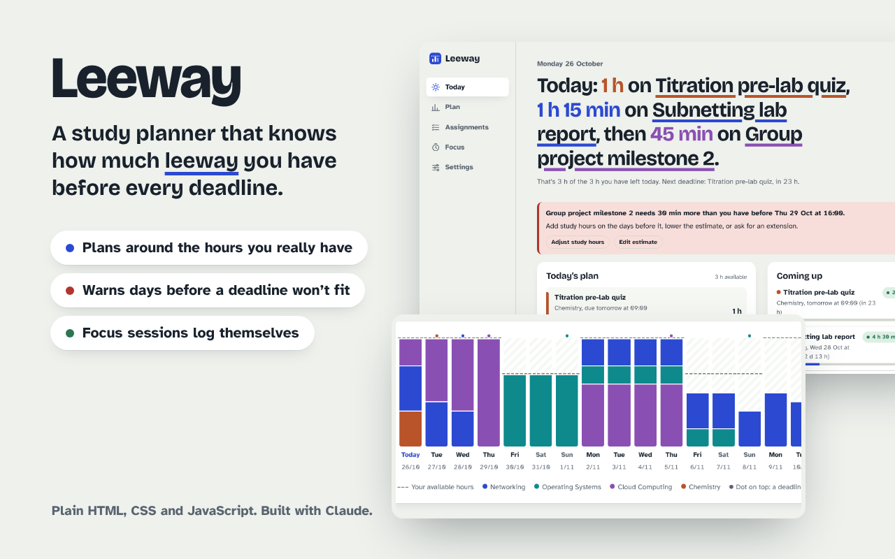

# Leeway – study planner

Leeway turns your assignment deadlines and rough time estimates into a day-by-day study plan that fits the hours you actually have. It tells you early when something won't fit, so you can ask for an extension or rearrange things while there's still time.

Built for *Mandatory Assignment 3: Vibe Coding* (approach A: solve an everyday problem).

**Live app:** https://alpacaqq.github.io/leeway-study-planner/



## The problem

Most to-do apps know *when* things are due, but not *how long* they take or *how much time you have*. So everything looks fine until three deadlines land in the same week. Leeway answers one question: **how much leeway do I have before each deadline?**

## Features

- **Today view.** One sentence telling you what to work on today and for how long, plus warnings for anything that won't fit and a countdown for every deadline.
- **Automatic plan.** Enter a due date and an estimate in hours; Leeway spreads the work across your days, never planning more than the study hours you set per weekday. Switch between *Spread it out* and *Get ahead*.
- **Leeway per assignment.** Spare hours before each deadline, after everything due earlier is accounted for: *comfortable*, *tight* or *short by X h*.
- **14-day load chart.** Each day is a bar: coloured blocks per course, a dashed line for your available hours, a dot where a deadline falls.
- **Focus timer (Pomodoro).** 25/5 minutes with a long break every fourth round. Finished sessions are logged against the assignment and the plan updates. Survives a page reload.
- **Log time, mark done, undo.** Undo for delete and mark-done.
- **Calendar export (.ics)** of the plan and deadlines, **JSON backup/restore**, light/dark theme, works on phones.
- **Private by default.** Everything stays in your browser's localStorage. No accounts, no server, no tracking.

## How the planning works

Everything is scheduled in 15-minute units, in `js/planner.js` (pure functions, no DOM, unit-tested in Node).

1. **Capacity.** Each day gets the hours you set for that weekday. Today is reduced by time already logged and by how much of the day is left.
2. **Last working day.** Due in the afternoon or evening, the due day counts. Due before noon, the day before is the last working day.
3. **Spread mode** (default). Each day, every open assignment gets a share of its remaining work proportional to that day's share of the capacity left before its deadline, earliest deadline first.
4. **Safety net.** The plan is also computed with *earliest-deadline-first, as soon as possible*, which is optimal for "can everything fit?". If spreading would miss a deadline that ASAP could meet, Leeway uses the ASAP plan and says so.
5. **Leeway** = capacity before the deadline − remaining work of this and every earlier-due assignment.

## How I used AI

The whole app was vibe-coded with **Claude (Opus 5.5)** in the Claude app, which wrote, ran and tested the code in a sandbox.

1. **Brainstorm.** Asked for app ideas that fit the assignment; picked the study planner.
2. **Plan.** Claude proposed the core idea (leeway = slack before each deadline), the data model, the scheduling approach and a visual direction.
3. **Build.** Planning engine first (with tests), then the interface in plain HTML/CSS/JS with no framework or build step.
4. **Test and improve**: see below.
5. **Publish.** Pushed to GitHub, hosted on GitHub Pages, demo posted to Vibe Off.

## Testing and what it caught

| Check | Tool | Result |
|---|---|---|
| Planner unit tests (17), incl. a 40-assignment randomized stress test | `node --test` | all pass |
| End-to-end tests (15): forms, validation, plan, log time, focus timer with a fake clock, undo, settings, calendar export, backup/import, XSS, mobile layout | Playwright | all pass |
| Accessibility audit, all 5 views, light and dark | axe-core (WCAG 2 A/AA) | 0 violations |
| Visual review | Screenshots at 1280 px and 390 px, light and dark | reviewed every view |

Bugs found and fixed along the way:

- **Boundary bug:** an assignment with exactly 1 h of slack wasn't marked *tight* (`<` vs `<=`). Caught by a unit test.
- **Spreading missed deadlines with uneven weekly hours.** A randomized search over 20,000 scenarios found cases where even spreading left the big days unused. Switched to capacity-proportional spreading: fallbacks dropped to **0 of 20,000**. The failing case is now a regression test.
- **Plan page scrolled sideways on phones** (CSS grid min-width). Caught by the mobile-overflow e2e test, same bug on the Focus page and the course list.
- **Accessibility:** progress bars missing a role, amber chip at 4.36:1 contrast (now above 4.5:1), course colours too dark as text in dark mode.
- **Copy and layout polish from screenshots:** "Tomorrow" capitalised mid-sentence, "Tight: 0 min spare" reworded, an empty timer box showing in the sidebar, cramped buttons on mobile.

## Run it locally

No build step. Any static server works:

```bash
python3 -m http.server 8000
# open http://localhost:8000
```

Run the tests:

```bash
node --test tests/planner.test.js
pip install playwright && python -m playwright install chromium
python tests/e2e_test.py
```

## What's next

- Sync between devices (today the data lives in one browser; export/import is the workaround).
- Import deadlines from Canvas or a calendar feed instead of typing them.
- Learn from logged time: if you usually take 30% longer than estimated, adjust future estimates.
- Fixed time slots within a day (the plan is per day, not per hour).

## Project structure

```
index.html        app shell, dialogs
styles.css        design tokens, light/dark theme, layout
js/planner.js     scheduling engine (pure, testable)
js/app.js         views, state, focus timer, import/export
fonts/            Bricolage Grotesque + Atkinson Hyperlegible (SIL OFL)
tests/            unit tests (Node) and end-to-end tests (Playwright)
```

All sample data in the app is made up.
